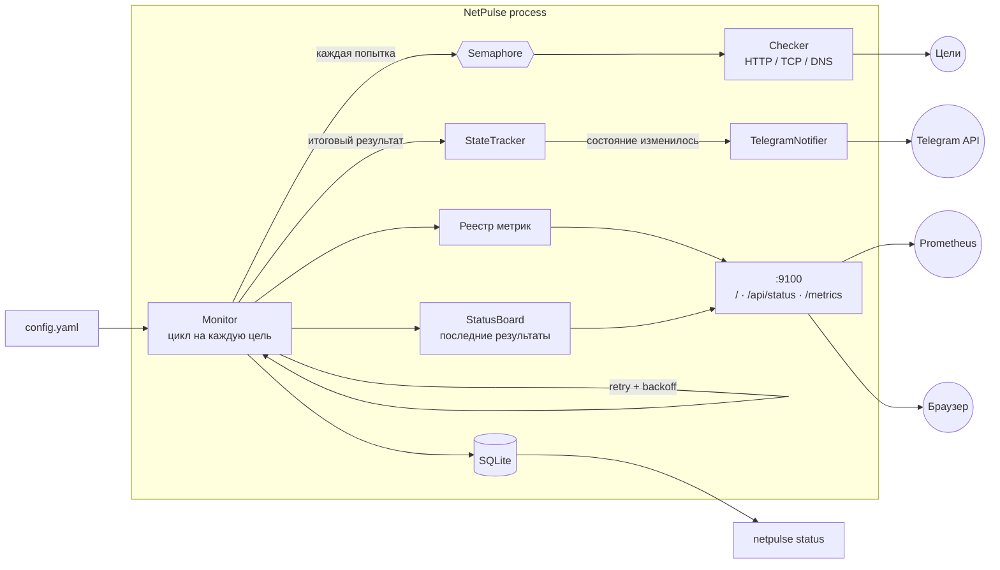

# NetPulse

Асинхронный мониторинг доступности HTTP-, TCP- и DNS-целей. Проверяет ваши сервисы по расписанию,
сохраняет каждый результат в SQLite, отдаёт метрики Prometheus и присылает сообщение в Telegram,
когда сервис упал или поднялся — и только в эти моменты, поэтому без спама.

## Зачем

Пинг URL из cron не говорит, *когда* именно что-то сломалось, срабатывает на единичной потере пакета
и напоминает о проблеме каждую минуту. NetPulse — небольшая self-hosted альтернатива: ретраи гасят
кратковременные сбои, алерты только при смене состояния не засоряют канал, а эндпоинт `/metrics`
встраивается в уже привычный стек Prometheus/Grafana.

## Возможности

- **Три типа целей** — HTTP(S) URL, TCP `host:port`, DNS-имя
- **HTTP-проверки** — код ответа, время ответа, срок действия TLS-сертификата (цель считается
  упавшей, если сертификат истекает раньше заданного числа дней)
- **Параллельные проверки** с ограничением через `asyncio.Semaphore`
- **Retry с экспоненциальной задержкой**, прежде чем сервис считается упавшим
- **Алерты в Telegram только при смене состояния** (упал / поднялся)
- **Страница статуса** на `/` — карточки целей, задержка, аптайм, срок SSL и полоска последних
  30 проверок; обновляется сама, данные берёт из `/api/status` (JSON)
- **Prometheus `/metrics`** — up/down, задержка, срок сертификата, счётчики проверок
- **История в SQLite**, CLI на Typer

## Архитектура



Один цикл проверки цели: попытка → (при неудаче) пауза `retry_base_delay * 2^n` и новая попытка, не
более `retries` раз → итоговый результат сохраняется, экспортируется в метрики и передаётся трекеру
состояния. Алерт уходит, только если состояние up/down *изменилось*.

## Быстрый старт

### Docker (одна команда)

```bash
docker compose up -d
```

Запускается с примером [`config.yaml`](config.yaml) и без алертов. Чтобы включить Telegram, создайте
бота через [@BotFather](https://t.me/BotFather) и выполните:

```bash
cp .env.example .env      # заполните NETPULSE_TELEGRAM_BOT_TOKEN и NETPULSE_TELEGRAM_CHAT_ID
docker compose up -d
```

Отредактируйте `config.yaml`, чтобы мониторить свои сервисы, и выполните `docker compose restart`.

```bash
docker compose exec netpulse netpulse status    # последние результаты
# страница статуса: http://localhost:9100
curl localhost:9100/metrics                     # метрики Prometheus
docker compose logs -f                          # смены состояния в логах
```

### Локально

Нужен Python 3.12.

```bash
pip install -e ".[dev]"
export NETPULSE_TELEGRAM_BOT_TOKEN=... NETPULSE_TELEGRAM_CHAT_ID=...   # необязательно
netpulse run -c config.yaml
```

## Конфигурация

```yaml
interval: 30              # секунд между проверками каждой цели
timeout: 10               # секунд до прерывания одной попытки
concurrency: 10           # максимум одновременных проверок
retries: 3                # дополнительных попыток до DOWN (паузы 1с, 2с, 4с по умолчанию)
retry_base_delay: 1
ssl_expiry_warn_days: 14  # HTTPS-цель падает, если сертификат истекает раньше
database: netpulse.db
metrics_host: 127.0.0.1
metrics_port: 9100

targets:
  - {name: Website, type: http, url: "https://example.com", expected_status: 200}
  - {name: Postgres, type: tcp, host: db.internal, port: 5432}
  - {name: Domain, type: dns, host: example.com}
```

Неизвестные ключи, дубликаты имён целей и некорректные значения отклоняются при старте с понятной
ошибкой. Секреты читаются только из окружения (см. [`.env.example`](.env.example)). Если переменные
Telegram не заданы, NetPulse пишет предупреждение в лог и работает без алертов.

## CLI

```text
netpulse run    [-c config.yaml]     Мониторить все цели, пока процесс не остановят
netpulse check  <target>             Разовая проверка; код выхода 1, если цель недоступна
netpulse status [-c config.yaml]     Последнее состояние и аптайм за 24 часа из SQLite
```

`<target>` — URL `http(s)://`, `host:port` (TCP) или просто имя (DNS). Вместо `-c` можно задать
переменную `NETPULSE_CONFIG`.

```console
$ netpulse check https://example.com
OK   https://example.com status=200 394ms ssl=75d

$ netpulse check db.internal:5432
FAIL db.internal:5432 - ConnectionRefusedError: [Errno 111] Connection refused

$ netpulse status
TARGET   STATE  LATENCY  UPTIME 24H  CHECKED (UTC)        ERROR
Domain   UP     1 ms     100.0%      2026-10-11 01:05:17
Postgres DOWN   -        0.0%        2026-10-11 01:05:17  ConnectionRefusedError: ...
Website  UP     332 ms   99.9%       2026-10-11 01:05:17
```

## Метрики

`GET /metrics` (текстовый формат Prometheus):

| Метрика | Тип | Значение |
| --- | --- | --- |
| `netpulse_up{target}` | gauge | 1, если последняя проверка успешна, иначе 0 |
| `netpulse_latency_seconds{target}` | gauge | Время ответа последней проверки (отсутствует, пока цель не отвечает) |
| `netpulse_ssl_expiry_days{target}` | gauge | Дней до истечения HTTPS-сертификата |
| `netpulse_checks_total{target,result}` | counter | Завершённые проверки по исходу `ok` / `fail` |

Аптайм за период — это запрос, а не хранимое число:

```promql
avg_over_time(netpulse_up{target="Website"}[24h])      # доля аптайма за 24 часа
netpulse_latency_seconds{target="Website"}             # задержка
netpulse_ssl_expiry_days < 21                          # сертификаты, истекающие скоро
```

Конфиг скрейпа Prometheus:

```yaml
scrape_configs:
  - job_name: netpulse
    static_configs:
      - targets: ["netpulse:9100"]
```

## Технические решения

- **asyncio и один `httpx.AsyncClient`.** Проверки завязаны на ввод-вывод; одного цикла событий
  хватает на сотни целей без потоков. Клиент общий (пул соединений) и корректно закрывается при выходе.
- **Семафор на *попытку*, а не на цикл.** Цель, ждущая между ретраями, не занимает слот, поэтому один
  «мигающий» сервис не может заморить остальные проверки.
- **Алерты по смене состояния, считаемой по *итоговому* результату.** Сначала ретраи: цель считается
  упавшей, только когда провалились все попытки. Первая проверка цели с неизвестным состоянием шлёт
  алерт, только если цель недоступна.
- **Состояние переживает перезапуск.** Трекер заполняется последними строками из SQLite, поэтому
  после рестарта NetPulse не объявляет повторно о сервисе, который всё ещё лежит.
- **Истечение сертификата — это падение, а не отдельный тип алерта.** В пределах
  `ssl_expiry_warn_days` цель переходит в DOWN, а причина указывается в сообщении. Один конвейер
  алертов и один автомат состояний.
- **Задержка HTTP — время до заголовков ответа.** Тело читается потоком и не скачивается, поэтому
  большая страница не искажает измерение и не тратит трафик. Редиректы выполняются.
- **Единый дедлайн на попытку** через `asyncio.timeout`, поэтому `timeout` означает одно и то же для
  HTTP, TCP и DNS (собственные таймауты httpx действуют по фазам).
- **Сетевые сбои — это результаты, а не исключения.** `Checker.check` возвращает неудачный
  `CheckResult`; цикл могут уронить только программные ошибки. Ошибки доставки в Telegram логируются
  и подавляются, чтобы сломанный канал алертов не останавливал мониторинг.
- **Токен бота не попадает в логи.** URL Telegram содержит токен, поэтому логируются только тип
  исключения или HTTP-статус, а INFO-логирование запросов `httpx` отключено.
- **Обычный `sqlite3`, режим WAL.** Запись — вставка одной строки за доли миллисекунды, так что
  блокировка цикла на это дешевле, чем переход в поток или лишняя зависимость. WAL позволяет
  `netpulse status` читать, пока монитор пишет.
- **`prometheus_client` для эндпоинта.** Корректный формат экспозиции и готовый HTTP-сервер в
  фоновом потоке вместо самодельного HTTP. Конфиг валидируется pydantic, поэтому опечатки
  всплывают при старте, а не в три часа ночи.
- **Метрики по соглашениям Prometheus.** `netpulse_up` и счётчик позволяют Prometheus считать аптайм
  за любое окно; никаких собственных скользящих окон, в которых легко ошибиться.

### Ограничения

Результаты не удаляются (примерно одна строка на цель за интервал): при необходимости чистите старые
строки или ротируйте файл базы. Конфиг читается при старте — для применения изменений перезапустите
сервис.

## Разработка

```bash
pip install -e ".[dev]"
ruff check . && ruff format --check .
mypy src
pytest
```

Тесты подменяют сеть (`httpx.MockTransport`, заглушки `asyncio.open_connection` / `getaddrinfo`) и
проверяют то, что действительно важно: тайминги retry/backoff, переходы up/down без повторных
алертов, сохранение состояния при перезапуске, лимит параллелизма, обработку срока сертификата и
отсутствие токена в логах. CI (GitHub Actions) запускает линтер, проверку типов и тесты на каждый push.
