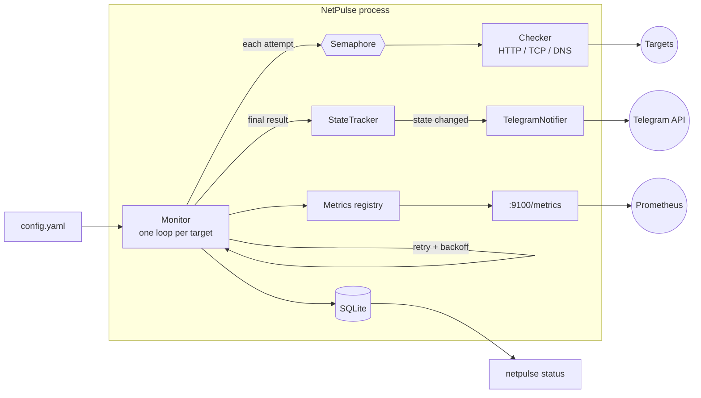

# NetPulse

Async uptime monitor for HTTP, TCP and DNS targets. It checks your services on a schedule, stores
every result in SQLite, exposes Prometheus metrics, and sends a Telegram message when a service goes
down or comes back — and only then, so there is no alert spam.

## Why

Pinging a URL from cron tells you nothing about *when* something broke, flaps on a single dropped
packet, and nags you every minute. NetPulse is a small, self-hosted alternative: retries absorb
transient blips, state-change alerts keep the channel quiet, and a `/metrics` endpoint plugs into
the Prometheus/Grafana stack you probably already have.

## Features

- **Three target types** — HTTP(S) URL, TCP `host:port`, DNS name
- **HTTP checks** — status code, response time, TLS certificate expiry (fails when it expires within
  a configurable number of days)
- **Parallel checks** bounded by an `asyncio.Semaphore`
- **Retry with exponential backoff** before a service is considered down
- **Telegram alerts on state change only** (down / recovered)
- **Prometheus `/metrics`** — up/down, latency, certificate expiry, check counters
- **SQLite history**, CLI built with Typer

## Architecture



One check cycle for a target: attempt → (on failure) sleep `retry_base_delay * 2^n` and attempt again,
up to `retries` times → the final result is saved, exported as metrics, and fed to the state tracker.
Only if the up/down state *changed* is an alert sent.

## Quick start

### Docker (one command)

```bash
docker compose up -d
```

This runs with the sample [`config.yaml`](config.yaml) and no alerts. To enable Telegram, create a
bot with [@BotFather](https://t.me/BotFather), then:

```bash
cp .env.example .env      # fill in NETPULSE_TELEGRAM_BOT_TOKEN and NETPULSE_TELEGRAM_CHAT_ID
docker compose up -d
```

Edit `config.yaml` to monitor your own services and run `docker compose restart`.

```bash
docker compose exec netpulse netpulse status    # latest results
curl localhost:9100/metrics                     # Prometheus metrics
docker compose logs -f                          # follow state changes
```

### Local

Requires Python 3.12.

```bash
pip install -e ".[dev]"
export NETPULSE_TELEGRAM_BOT_TOKEN=... NETPULSE_TELEGRAM_CHAT_ID=...   # optional
netpulse run -c config.yaml
```

## Configuration

```yaml
interval: 30              # seconds between checks of each target
timeout: 10               # seconds before a single attempt is aborted
concurrency: 10           # max checks in flight at once
retries: 3                # extra attempts before DOWN (1s, 2s, 4s backoff by default)
retry_base_delay: 1
ssl_expiry_warn_days: 14  # HTTPS targets fail when the certificate expires sooner
database: netpulse.db
metrics_host: 127.0.0.1
metrics_port: 9100

targets:
  - {name: Website, type: http, url: "https://example.com", expected_status: 200}
  - {name: Postgres, type: tcp, host: db.internal, port: 5432}
  - {name: Domain, type: dns, host: example.com}
```

Unknown keys, duplicate target names and invalid values are rejected at startup with a readable
error. Secrets are read only from the environment (see [`.env.example`](.env.example)). If the
Telegram variables are unset, NetPulse logs a warning and runs without alerts.

## CLI

```text
netpulse run    [-c config.yaml]     Monitor all targets until stopped
netpulse check  <target>             One-off check; exit code 1 if down
netpulse status [-c config.yaml]     Latest state and 24h uptime from SQLite
```

`<target>` is an `http(s)://` URL, `host:port` (TCP), or a bare name (DNS). `-c` can also be set
with `NETPULSE_CONFIG`.

```console
$ netpulse check https://example.com
OK   https://example.com status=200 394ms ssl=75d

$ netpulse check db.internal:5432
FAIL db.internal:5432 - ConnectionRefusedError: [Errno 111] Connection refused

$ netpulse status
TARGET   STATE  LATENCY  UPTIME 24H  CHECKED (UTC)        ERROR
Domain   UP     1 ms     100.0%      2026-10-11 01:05:17
Postgres DOWN   -        0.0%        2026-10-11 01:05:17  ConnectionRefusedError: ...
Website  UP     332 ms   99.9%       2026-10-11 01:05:17
```

## Metrics

`GET /metrics` (Prometheus text format):

| Metric | Type | Meaning |
| --- | --- | --- |
| `netpulse_up{target}` | gauge | 1 if the last check succeeded, else 0 |
| `netpulse_latency_seconds{target}` | gauge | Response time of the last check (absent while the target doesn't answer) |
| `netpulse_ssl_expiry_days{target}` | gauge | Days until the HTTPS certificate expires |
| `netpulse_checks_total{target,result}` | counter | Completed checks by `ok` / `fail` |

Uptime over a window is a query, not a stored number:

```promql
avg_over_time(netpulse_up{target="Website"}[24h])      # 24h uptime ratio
netpulse_latency_seconds{target="Website"}             # latency
netpulse_ssl_expiry_days < 21                          # certificates expiring soon
```

Prometheus scrape config:

```yaml
scrape_configs:
  - job_name: netpulse
    static_configs:
      - targets: ["netpulse:9100"]
```

## Technical decisions

- **asyncio + one `httpx.AsyncClient`.** Checks are I/O-bound; a single event loop handles hundreds
  of targets without threads. The client is shared for connection pooling and closed cleanly on exit.
- **Semaphore per *attempt*, not per cycle.** A target sleeping in retry backoff does not hold a
  slot, so one flapping service can't starve the others.
- **Alerts on state change, derived from the *final* result.** Retries run first; a target is DOWN
  only after all attempts fail. The first check of an unknown target alerts only if it is down.
- **State survives restarts.** The tracker is seeded from the latest SQLite rows, so restarting
  NetPulse doesn't re-announce a service that is still down.
- **Certificate expiry is a failure, not a separate alert type.** Within `ssl_expiry_warn_days` the
  target goes DOWN with the reason in the message. One alert pipeline, one state machine.
- **HTTP latency = time to response headers.** The body is streamed and never downloaded, so a
  large page can't skew the measurement or burn bandwidth. Redirects are followed.
- **One overall deadline per attempt** via `asyncio.timeout`, so `timeout` means the same thing for
  HTTP, TCP and DNS (httpx's own timeouts apply per phase).
- **Network failures are results, not exceptions.** `Checker.check` returns a failed `CheckResult`;
  only programming errors can crash the loop. Telegram delivery failures are logged and swallowed so
  a broken alert channel never stops monitoring.
- **No bot token in logs.** The Telegram URL contains the token, so only the exception type or HTTP
  status is logged and `httpx`'s per-request INFO logging is silenced.
- **Plain `sqlite3`, WAL mode.** Writes are single-row inserts taking well under a millisecond, so
  blocking the loop for them is cheaper than a thread hop or an extra dependency. WAL lets
  `netpulse status` read while the monitor writes.
- **`prometheus_client` for the endpoint.** Correct exposition format and a ready HTTP server on a
  background thread, instead of hand-rolling HTTP. Config is validated with pydantic, so typos fail
  at startup rather than at 3 a.m.
- **Metrics follow Prometheus conventions.** `netpulse_up` plus a counter lets Prometheus compute
  uptime over any window; no in-process rolling windows to get wrong.

### Limitations

Results are never pruned (about one row per target per interval); delete old rows or rotate the
database file if that matters to you. Config is read at startup — restart to apply changes.

## Development

```bash
pip install -e ".[dev]"
ruff check . && ruff format --check .
mypy src
pytest
```

Tests mock the network (`httpx.MockTransport`, patched `asyncio.open_connection` / `getaddrinfo`)
and focus on behaviour that matters: retry/backoff timing, up/down transitions without duplicate
alerts, alerts surviving a restart, the concurrency limit, certificate-expiry handling, and token
safety in logs. CI (GitHub Actions) runs lint, type check and tests on every push.
