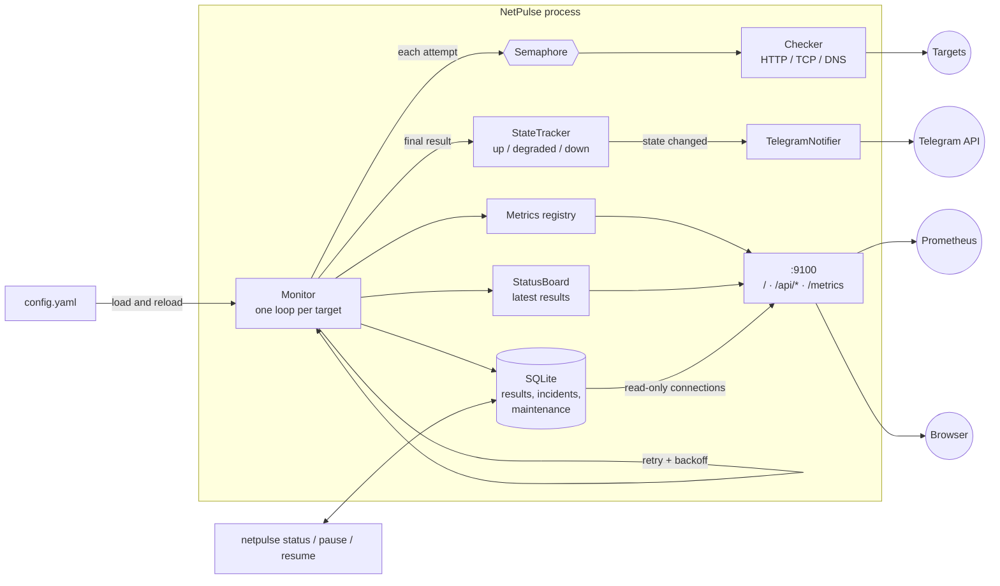

# NetPulse

Async uptime monitor for HTTP, TCP and DNS targets. It checks your services on a schedule, keeps
every result and every outage in SQLite, serves a live status page and Prometheus metrics, and sends
a Telegram message when a service goes down, gets slow, or recovers — and only then, so there is no
alert spam.

## Why

Pinging a URL from cron tells you nothing about *when* something broke, flaps on a single dropped
packet, and nags you every minute. NetPulse is a small, self-hosted alternative: retries absorb
transient blips, state-change alerts keep the channel quiet, the history survives restarts, and a
`/metrics` endpoint plugs into the Prometheus/Grafana stack you probably already have.

## Features

- **Three target types** — HTTP(S) URL, TCP `host:port`, DNS name
- **HTTP checks** — status code, response time, TLS certificate expiry, optional method, headers and
  an expected substring in the response body
- **Parallel checks** bounded by an `asyncio.Semaphore`; **retry with exponential backoff** before a
  service is considered down
- **Incidents** — every outage is stored (target, start, end, duration, first error); the recovery
  alert says how long it lasted
- **Uptime for 24 hours and 7 days** computed from the database, so it survives restarts and does not
  count the time the monitor itself was off
- **Degraded state** — a latency threshold (global and per target) separates "slow" from "down", with
  its own yellow card and alerts
- **Per-target settings** — interval, timeout, retries, latency threshold
- **Maintenance mode** — `paused: true` or `netpulse pause <name>`: no checks, no alerts, a grey card
- **Live config reload** — edit `config.yaml` and targets appear, change or disappear without a restart;
  mistakes are explained in plain language and the old config keeps running
- **Status page** on `/` with a detail panel (24-hour latency chart, incidents) per target
- **Telegram alerts on state change only**; **Prometheus `/metrics`**; **CLI** built with Typer

## Screenshots

| Status page | Target details |
| --- | --- |
|  |  |

| On a phone | Maintenance and degraded states |
| --- | --- |
|  |  |

The page UI is in Russian; everything else (CLI, logs, alerts, docs) is English.

## Architecture



One check cycle for a target: attempt → (on failure) sleep `retry_base_delay * 2^n` and try again, up
to `retries` times → the final result is classified (up / degraded / down), saved, exported as metrics
and fed to the state tracker. Only when the state *changed* is an alert sent and an incident opened or
closed.

## Quick start

### Docker (one command)

```bash
docker compose up -d
```

This runs with the sample [`config.yaml`](config.yaml) and no alerts. Open <http://localhost:9100> for
the status page. To enable Telegram, create a bot with [@BotFather](https://t.me/BotFather), then:

```bash
cp .env.example .env      # fill in NETPULSE_TELEGRAM_BOT_TOKEN and NETPULSE_TELEGRAM_CHAT_ID
docker compose up -d
```

Edit `config.yaml` to monitor your own services; running NetPulse picks the changes up by itself.

```bash
docker compose exec netpulse netpulse status          # latest results
docker compose exec netpulse netpulse pause Website   # start maintenance
curl localhost:9100/metrics                           # Prometheus metrics
docker compose logs -f                                # state changes and reloads
```

Compose mounts `config.yaml` as a single file. Editors that save by replacing the file (some replace
it with a new inode) can leave the container looking at the old one; if a change is not picked up,
run `docker compose restart`.

### Local

Requires Python 3.12.

```bash
pip install -e ".[dev]"
export NETPULSE_TELEGRAM_BOT_TOKEN=... NETPULSE_TELEGRAM_CHAT_ID=...   # optional
netpulse run -c config.yaml
```

## Configuration

```yaml
interval: 30              # seconds between checks of each target
timeout: 10               # seconds before a single attempt is aborted
concurrency: 10           # max checks in flight at once
retries: 3                # extra attempts before DOWN (1s, 2s, 4s backoff by default)
retry_base_delay: 1
ssl_expiry_warn_days: 14  # HTTPS targets fail when the certificate expires sooner
degraded_ms: 1500         # slower than this = DEGRADED; omit to turn the state off
database: netpulse.db
metrics_host: 127.0.0.1   # the status page and /metrics share this address
metrics_port: 9100

targets:
  - {name: Website, type: http, url: "https://example.com", expected_status: 200}
  - {name: Postgres, type: tcp, host: db.internal, port: 5432}
  - {name: Domain, type: dns, host: example.com}
```

Every target can override `interval`, `timeout`, `retries` and `degraded_ms`, and be put into
maintenance with `paused: true`. HTTP targets have three more options:

```yaml
  - name: Orders API
    type: http
    url: https://api.example.com/health
    method: POST                                   # GET (default), HEAD, POST, PUT, PATCH, DELETE, OPTIONS
    headers: {Authorization: "Bearer ${API_TOKEN}"}  # ${VAR} is read from the environment
    body_contains: '"status":"ok"'                 # must appear in the first 1 MiB of the body
    interval: 10
    degraded_ms: 400
```

- `${VAR}` in header values keeps tokens out of the config file; a missing variable is a config error.
- `body_contains` is matched against the body decoded with the response's charset. It cannot be combined
  with `method: HEAD`.
- Secrets such as the Telegram token are read only from the environment (see
  [`.env.example`](.env.example)). Without them NetPulse logs a warning and runs without alerts.

### Reloading

`config.yaml` is watched while NetPulse runs (checked every 2 seconds):

- **Added** targets start being checked and appear on the page; **removed** ones disappear, their open
  incident is closed and their metrics are dropped; **changed** ones are restarted with the new spec;
  **untouched** ones keep running with their state, so a reload never repeats an alert.
- Global `interval`, `timeout`, `retries`, `retry_base_delay`, `ssl_expiry_warn_days` and `degraded_ms`
  apply from the next cycle.
- `database`, `metrics_host`, `metrics_port` and `concurrency` are read once; changing them logs a
  warning and needs a restart.
- A broken edit never stops monitoring: the previous config keeps running, and the reason is logged and
  shown at the top of the status page until the file is fixed.

### Config errors

Mistakes are reported all at once, in file order, with the line, the target, a hint for misspelled keys,
and no library internals (messages are in Russian):

```text
Ошибка: ошибки в config.yaml:
  • параметр «intervall» (строка 2): неизвестный параметр (возможно, «interval»?)
  • цель №2 «db», параметр «port» (строка 6): обязательный параметр не задан
  • цель №3 «x» (строка 7): неизвестный тип «ftp»: допустимо http, tcp или dns
```

The CLI exits with code 2 on a config error.

## CLI

```text
netpulse run    [-c config.yaml]     Monitor all targets until stopped
netpulse check  <target>             One-off check; exit code 1 if down
netpulse status [-c config.yaml]     Latest state and 24h / 7d uptime from SQLite
netpulse pause  <name> [-c ...]      Put a target into maintenance
netpulse resume <name> [-c ...]      Take it out again
```

`<target>` is an `http(s)://` URL, `host:port` (TCP), or a bare name (DNS). `-c` can also be set with
`NETPULSE_CONFIG`.

```console
$ netpulse check https://example.com
OK   https://example.com status=200 394ms ssl=75d

$ netpulse status
TARGET    STATE     LATENCY  UPTIME 24H  UPTIME 7D  CHECKED (UTC)        ERROR
Domain    UP        1 ms     100%        100%       2026-10-11 01:05:17
Postgres  DOWN      -        96.44%      98.10%     2026-10-11 01:05:17  ConnectionRefusedError: ...
Reports   PAUSED    -        100%        99.87%     2026-10-11 00:41:02
Website   DEGRADED  1830 ms  99.90%      99.95%     2026-10-11 01:05:17
```

`pause` and `resume` write to SQLite, so they work against a running monitor (and with a read-only
config mount) and take effect within 5 seconds. A target paused by `paused: true` in the config can only
be resumed by editing the config.

## Status page and API

The status page lives on `/` (same port as `/metrics`). Cards show state, latency, uptime for 24 hours
and 7 days, SSL expiry and the last 30 checks; click one (or press Enter) for the detail panel. The
page refreshes itself every 5 seconds and works on phone widths.

| Endpoint | Returns |
| --- | --- |
| `GET /` | the status page |
| `GET /api/status` | every target: `state` (`up`, `degraded`, `down`, `paused`, `pending`), latency, `uptime_24h`, `uptime_7d`, `interval`, `degraded_ms`, SSL days, last error, last 30 checks; plus `config_error` (null when the last reload worked) |
| `GET /api/incidents?limit=20&target=NAME` | incidents, newest first: `started_at`, `ended_at` (null while ongoing), `duration_seconds`, `first_error`. `limit` is 1–100 |
| `GET /api/history?target=NAME` | the target's last 24 hours as 5-minute slots: `avg_ms`, `max_ms`, `checks`, `failures`, plus the `degraded_ms` threshold |
| `GET /metrics` | Prometheus text format |

Unknown targets give `404`, bad parameters `400`, both as `{"error": "..."}`. `/api/status` also keeps
`uptime` and `checks`, which count only since the process started; the page uses `uptime_24h` and
`uptime_7d` instead.

```console
$ curl -s 'localhost:9100/api/incidents?limit=1&target=Website'
{"incidents": [{"id": 12, "target": "Website", "started_at": "2026-10-11T00:41:03+00:00",
  "ended_at": "2026-10-11T00:46:15+00:00", "ongoing": false, "duration_seconds": 312,
  "first_error": "ConnectError: connection refused"}]}
```

## How states, incidents and uptime work

- **Up / degraded / down.** A target is *down* when all attempts fail (status code, certificate, body
  text, connection, timeout). It is *degraded* when it answers correctly but slower than its latency
  threshold; degraded is not down: it counts as up in uptime, opens no incident and has its own alerts
  ("is DEGRADED", "latency is back to normal").
- **Alerts** go out only on a change: down, recovered (with the downtime and, if it is still slow, a
  note), degraded, back to normal. A target with no known state alerts if its first check fails or is
  slow, and stays silent if it is fine. Restarting NetPulse does not repeat alerts: the state is read
  back from the database.
- **Incidents** are stored from the first failed result to the first successful one. Existing history
  is converted into incidents when the database is upgraded.
- **Uptime** is the share of successful checks stored in the database over the last 24 hours or 7 days.
  Because it is a ratio of checks that actually ran, the hours when NetPulse itself was stopped count
  neither as up nor as down. A window without checks shows "—".
- **Maintenance** closes the target's open incident, forgets its state and removes its metrics. Nothing
  is alerted about the pause, and after resuming the target is judged afresh: a service that is back up
  does *not* send a "recovered" message.

## Metrics

`GET /metrics` (Prometheus text format):

| Metric | Type | Meaning |
| --- | --- | --- |
| `netpulse_up{target}` | gauge | 1 if the last check succeeded (also when degraded), else 0 |
| `netpulse_degraded{target}` | gauge | 1 if the target answers but slower than its threshold |
| `netpulse_latency_seconds{target}` | gauge | Response time of the last check (absent while the target doesn't answer) |
| `netpulse_ssl_expiry_days{target}` | gauge | Days until the HTTPS certificate expires |
| `netpulse_checks_total{target,result}` | counter | Completed checks by `ok` / `fail` |

Series of paused or removed targets are dropped, so nothing stale is left behind. Uptime over a window
is also available in PromQL:

```promql
avg_over_time(netpulse_up{target="Website"}[24h])      # 24h uptime ratio
netpulse_latency_seconds{target="Website"}             # latency
netpulse_degraded == 1                                 # slow targets
netpulse_ssl_expiry_days < 21                          # certificates expiring soon
```

Prometheus scrape config:

```yaml
scrape_configs:
  - job_name: netpulse
    static_configs:
      - targets: ["netpulse:9100"]
```

## Technical decisions

- **asyncio and one `httpx.AsyncClient`.** Checks are I/O-bound; a single event loop handles hundreds
  of targets without threads. The client is shared for connection pooling and closed cleanly on exit.
- **Semaphore per *attempt*, not per cycle.** A target sleeping in retry backoff does not hold a
  slot, so one flapping service can't starve the others.
- **Alerts on state change, derived from the *final* result.** Retries run first; a target is DOWN
  only after all attempts fail.
- **State survives restarts.** The tracker is seeded from the latest SQLite rows, so restarting
  NetPulse doesn't re-announce a service that is still down or still slow.
- **Degraded is a flag on a successful result, not a third kind of failure.** `ok` stays true, so the
  uptime query, the incident logic and `netpulse_up` need no special cases.
- **Uptime is a ratio of stored checks.** It needs no bookkeeping of when the monitor ran, cannot count
  its own downtime against a target, and is one indexed query, cached for 30 seconds for the page.
- **Incidents come from state-change events, not from scanning results.** Opening and closing is
  idempotent, so a restart in the middle of an outage continues the same incident.
- **Certificate expiry is a failure, not a separate alert type.** Within `ssl_expiry_warn_days` the
  target goes DOWN with the reason in the message. One alert pipeline, one state machine.
- **HTTP latency = time to response headers.** The body is streamed and only read when
  `body_contains` asks for it (capped at 1 MiB), so a large page can't skew the measurement or burn
  bandwidth. Redirects are followed.
- **One overall deadline per attempt** via `asyncio.timeout`, so `timeout` means the same thing for
  HTTP, TCP and DNS (httpx's own timeouts apply per phase).
- **Network failures are results, not exceptions.** `Checker.check` returns a failed `CheckResult`;
  only programming errors can crash the loop. Telegram delivery failures are logged and swallowed so
  a broken alert channel never stops monitoring.
- **No bot token in logs.** The Telegram URL contains the token, so only the exception type or HTTP
  status is logged and `httpx`'s per-request INFO logging is silenced.
- **Plain `sqlite3`, WAL mode, versioned migrations.** Writes are single-row inserts taking well under
  a millisecond, so blocking the loop for them is cheaper than a thread hop or an extra dependency.
  WAL lets the HTTP threads and the CLI read while the monitor writes; each HTTP request uses its own
  read-only connection. Schema changes are an append-only list tracked in `PRAGMA user_version` and
  applied in one transaction; databases created by earlier versions keep their data, and a database
  from a newer NetPulse is refused instead of downgraded.
- **Pause state lives in SQLite, not in the config.** A CLI that rewrote YAML would lose comments and
  fail on a read-only mount; the database is shared with the running monitor anyway.
- **Config reload is polling plus validate-then-swap.** `stat` every 2 seconds works the same on
  Linux, macOS, Windows and Docker mounts, and a file that fails validation is never half-applied.
- **Stdlib `http.server` and no web framework.** One small threaded server serves the page, the JSON
  and `/metrics`; the page is a single static HTML file with no build step, and renders user data only
  through `textContent`. `prometheus_client` provides the exposition format. Config is validated with
  pydantic, so typos fail at startup (or at reload) rather than at 3 a.m.

### Limitations

- Results are never pruned (about one row per target per interval): delete old rows or rotate the
  database file if that matters to you.
- An incident that spans a period when NetPulse itself was stopped reports the whole span as its
  duration; only the uptime percentages exclude monitor downtime.
- A single slow response is enough to alert "DEGRADED" (and the next normal one "back to normal"); there
  is no debounce, so pick a threshold with some headroom.
- Removing a target (or renaming it) hides its history on the page; the rows stay in the database.

## Development

```bash
pip install -e ".[dev]"
ruff check . && ruff format --check .
mypy src
pytest
```

Tests mock the network (`httpx.MockTransport`, patched `asyncio.open_connection` / `getaddrinfo`)
and focus on behaviour that matters: retry/backoff timing, up/degraded/down transitions without
duplicate alerts, incidents and downtime, uptime across monitor outages, maintenance, config reload,
config error messages, schema migrations of old databases, the HTTP API, the concurrency limit,
certificate-expiry handling and token safety in logs. CI (GitHub Actions) runs lint, type check and
tests on every push.
